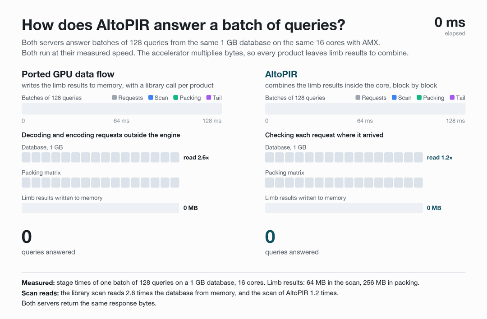
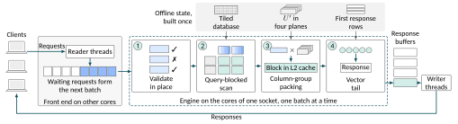
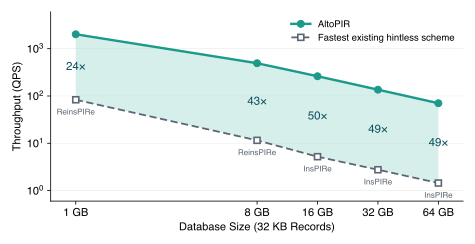

<p align="center">
  
</p>

<h1 align="center">AltoPIR</h1>

<p align="center">
  <b>Hintless private information retrieval at high throughput, on the matrix accelerators inside server CPUs.</b>
</p>

<p align="center">
  <a href="LICENSE"></a>
  
  
</p>

<p align="center">
  <a href="#quick-start">Quick start</a> · <a href="#how-it-works">How it works</a> · <a href="#results">Results</a> · <a href="#demo">Demo</a> ·
  <a href="#usage">Usage</a> · <a href="#reproducing-the-figures">Reproducing the figures</a> · <a href="#tests">Tests</a>
</p>

---

AltoPIR is a system for private information retrieval (PIR). A client fetches one record from the database of the
server, and the server answers without learning which record it was. To hide the choice, the server reads the whole
database for every query. AltoPIR serves a hintless scheme, so a client downloads nothing before its first query and
has nothing to update when the database changes.

When many clients query at once, AltoPIR answers all waiting queries in one pass over the database. It runs the two
8-bit integer matrix products of the scheme on Intel AMX, the matrix accelerator inside each core of recent Xeon
CPUs. It needs no GPU, and the database stays in the main memory of the server.

<p align="center"></p>

## At a glance

- **24–50× the throughput** of the fastest existing hintless scheme on the same 16 cores, for databases of 1 GB to
  64 GB.
- **1.73–1.96× the throughput of a direct port** on databases of 1 GB and 8 GB. The port runs the data flow of a
  GPU PIR system on the same 16 cores with AMX, using vendor libraries for the matrix products.
- **Databases beyond the memory of a GPU.** On one NVIDIA A30, SandwichPIR, a GPU-based PIR system, answers 2.9–5.1×
  more queries per second than AltoPIR on 16 cores for databases of 1 GB to 16 GB. Databases of 32 GB and 64 GB do not
  fit in the 24 GB of memory of the A30, and AltoPIR serves them from the main memory of the server.
- **13.9 ms for a single query** on 1 GB, against 20.6 ms with Valar, the fastest existing hintless scheme for one
  query on the same 16 cores. The server never holds a request back to fill a batch.
- **Identical responses.** Every response equals, byte for byte, the response of the reference server of the scheme.
- **No hint and no GPU.** Clients keep no state, and one CPU server holds the whole database.

## How it works

<p align="center"></p>

Reader threads put incoming requests in one queue. Whenever the engine is free, it takes every waiting request as the
next batch, up to `--max-batch`. Batches grow when many clients query at once, and a request that arrives alone is
answered alone. The engine answers each batch in four steps on the cores of one socket.

1. **Validate in place.** Checks each request in the buffer where it arrived, and rejects a malformed request exactly
   when the decoder of the scheme would.
2. **Query-blocked scan.** Streams the database through AMX once per batch, in the order of the tiles, while one block
   of query limbs at a time stays in the L2 cache.
3. **Column-group packing.** Streams the public packing matrix once per batch against the keys of all clients, which
   stay in the L3 cache, and reduces each group of limb products in the L2 cache.
4. **Vector tail.** Finishes each response with AVX-512 instructions, straight into one of several response buffers.

Writer threads send the responses from that buffer while the engine answers the next batch. The tiled database, the
packing matrix, and the first rows of every response are built once at setup.

## Results

<p align="center"></p>

| Database | Records | Fastest existing hintless scheme | AltoPIR | Gain |
|---|---:|---:|---:|---:|
| 1 GB | 32K | 83.2 QPS (ReinsPIRe) | 2,013 QPS | 24.2× |
| 8 GB | 256K | 11.5 QPS (ReinsPIRe) | 492 QPS | 42.6× |
| 16 GB | 512K | 5.21 QPS (InsPIRe) | 261 QPS | 50.1× |
| 32 GB | 1M | 2.76 QPS (InsPIRe) | 136 QPS | 49.2× |
| 64 GB | 2M | 1.45 QPS (InsPIRe) | 70.2 QPS | 48.6× |

<sub>One socket (16 cores) of an Intel Xeon Silver 4514Y with AMX, records of 32 KB. The existing schemes are the
official implementations of InsPIRe, Valar (IPIR+SP), and ReinsPIRe, each in its fastest configuration on the same 16
cores.</sub>

## Demo

Three private lookups on real data, recorded from a demo page on a client machine that queries AltoPIR servers over the
network (one socket of the Xeon Silver 4514Y above). The client hashes or embeds the input and encrypts the request,
and the server reads its whole database for every lookup without learning the input or the bucket it falls in.
"Answer with" shows the same lookup at the speed of an existing hintless scheme, measured with its official
implementation on the same server. The demo page is not part of this repository.

**Leaked passwords.** Is a password among the 2.07 billion leaked passwords of Have I Been Pwned's Pwned Passwords,
and how often does it appear? The database holds 131,072 buckets of 90 KB (11.25 GB).

<p align="center"></p>

**Unsafe links.** Is a link, its host, or one of its parent domains among the 1.1 million phishing links and domains of
Phishing.Database? The database holds 16,384 buckets of 4 KB (64 MB), and every link sends six requests.

<p align="center"></p>

**Wikipedia passages.** Which passages of Simple English Wikipedia answer a question? The client embeds the question,
picks the two nearest of 8,192 public cluster centroids, and fetches those clusters of passages (1 GB in all).

<p align="center"></p>

## Quick start

```sh
git clone https://github.com/GyuyeongKim/AltoPIR-public.git
cd AltoPIR-public
cargo build --release
cargo test --release
./examples/quickstart.sh
```

The script starts a local server with 8,192 synthetic records of 32 KB. It fetches three records and checks them, then
sends 200 queries per second for five seconds and decrypts every response.

> [!NOTE]
> The build targets the CPU it runs on (`-march=native`), so build on the server.

**You need**

- Linux on x86-64 with Intel AMX, which comes with Xeon CPUs of the 4th generation or later and needs Linux 5.16 or
  later. `grep -c amx_int8 /proc/cpuinfo` prints a nonzero count on such a CPU. Without AMX, AltoPIR runs on AVX-512
  VNNI with `--method vnni`, which is slower.
- [rustup](https://rustup.rs), which installs the toolchain pinned in `rust-toolchain.toml`, and GCC with OpenMP.

AltoPIR is tested on a Xeon Silver 4514Y with Ubuntu 24.04, Linux 6.17, Rust 1.95.0, and GCC 13.3.
`.cargo/config.toml` sets `RUSTC_BOOTSTRAP=spiral_rs` because the spiral-rs dependency still enables a feature gate
that current Rust no longer needs. AltoPIR asks for transparent huge pages for its large buffers, which takes effect
when `/sys/kernel/mm/transparent_hugepage/enabled` is `madvise` or `always`.

## Usage

### Serve a database

```sh
numactl --membind=1 target/release/altopir server --rows 32768 --listen 0.0.0.0:7000 --cpus 17-31 --net-cpus 16
numactl --membind=1 target/release/altopir server --db records.bin --listen 0.0.0.0:7000 --cpus 17-31 --net-cpus 16
```

The first line serves 32,768 synthetic records, and the second serves the records in `records.bin`. The engine runs on
15 cores of the second socket, and the threads that read requests and write responses share the remaining core of that
socket. Bind the memory to the socket of the engine cores, as with `numactl` above. The server prints one JSON line
when it is ready, with the request and response sizes and the setup times, and `altopir stop ADDR` stops it.

The setup builds two copies of the database, one in the layout of the scheme and one in the layout of the tiles,
together with a packing matrix whose size does not depend on the number of records (1 GB for records of 32 KB). The
setup of a 1 GB database peaks at about 8 GB and that of a 32 GB database at about 70 GB. With `--method amx`, the
server then releases the copy in the layout of the scheme, which only VNNI reads. It also moves its memory to the NUMA
node of the engine cores, so a database whose setup does not fit in the memory of one node can be served with
`numactl --preferred=1` in place of `--membind=1`.

<details>
<summary><b>All server options</b></summary>

| Option | Default | Meaning |
|---|---|---|
| `--rows N` | | Serve N synthetic records (a power of two, at least 2,048) |
| `--db FILE` | | Serve the records in FILE, `--record-bytes` each. The count is padded to a power of two of at least 2,048 with empty records. |
| `--record-bytes B` | `32768` | Record size, a multiple of 2,048 bytes |
| `--listen ADDR` | `0.0.0.0:7000` | Address and port |
| `--cpus LIST` | all allowed | Cores of the engine, for example `16-31`. Use the cores of one socket. |
| `--net-cpus LIST` | the engine cores | Cores of the threads that read requests and write responses |
| `--setup-cpus LIST` | the engine cores | Cores of the setup |
| `--max-batch N` | `128` | Largest batch |
| `--queue N` | `512` | Requests that may wait. A request beyond this gets a busy reply. |
| `--response-buffers N` | `4` | Buffers that hold the responses of a batch while writer threads send them. The engine waits when all of them are in use. |
| `--method M` | `amx` | `amx` runs the products on AMX tiles, `vnni` with AVX-512 VNNI |
| `--log FILE` | | When the server stops, write the time of every batch and request as JSON lines |

</details>

### Fetch records and generate load

```sh
target/release/altopir query --server HOST:7000 --rows 32768 --index 17 --out record.bin
target/release/altopir load --server HOST:7000 --rows 32768 --rate 1000 --seconds 30 --verify
```

`query` fetches the given records, one fresh client key per record, and writes them to `--out`. With `--check`, it
compares each record with the synthetic record of that number.

`load` sends queries at random (Poisson) times at `--rate` queries per second over `--conns` connections (default 16).
It reports the answered queries per second and the latency from the scheduled send time to the response. With
`--verify`, it decrypts every response and compares it with the synthetic record. `--local-ip` and `--port-base` bind
each connection to a fixed local port. The client generates every query before the run, so its CPU cost is outside
the measured latency.

### Benchmark without the network

```sh
numactl --membind=1 target/release/altopir bench --rows 32768 --batches 1,128,256 --cpus 16-31 --client-cpus 0-15
```

```
 batch  method   median ms         QPS
     1     amx       14.00        71.4
   128     amx       64.44      1986.3
   256     amx      126.44      2024.7
```

`bench` answers batches of fresh queries inside one process and prints the median time of each batch size over
`--trials` runs (default 5) after one warmup. Every response is decrypted and checked outside the timed window.
Measure `amx` and `vnni` in separate runs, since the time of one depends on what ran on the cores just before.

### Wire format

| Direction | Frame (little endian) |
|---|---|
| Client to server | `[u32 length][u64 id][request]` |
| Server to client | `[u32 length][u64 id][i32 status][response]` |

Status 0 carries a response, 1 to 3 mark a malformed request, and 9 means that the queue was full. A request is the
request of the scheme. It holds a flag byte of 0, the two lengths of the packing key, the packing key (two vectors of
8,192 32-bit values below Q), and one 32-bit query value per record. On a database of N records, a request is
9 + 4 × (16,384 + N) bytes, and a response is 3.5 bytes per record byte.

## Reproducing the figures

```sh
./scripts/reproduce.sh
```

The script builds AltoPIR and the official implementations of ReinsPIRe, Valar (IPIR+SP), InsPIRe, and YPIR+SP,
measures all of them on the same cores, and draws three figures into `results/`.

- `throughput_comparison`: throughput on all engine cores for 1 GB and 8 GB databases, in queries and in database
  bytes per second.
- `throughput_vs_database_size`: throughput for databases of 1 GB to 64 GB, at the best batch size on all engine cores
  and for single queries on one core.
- `throughput_vs_batch_size`: AltoPIR with AMX and with AVX-512 VNNI for batches of 1 to 256 queries on a 1 GB
  database.

The measured values go to `results/summary.csv`. Every response of every scheme is decrypted and checked during the
runs.

**Existing schemes.** `baselines/` holds a benchmark program for each existing scheme. Its build script downloads the
official implementation at the commit below and builds the program against it.

| Scheme | Official implementation | Commit |
|---|---|---|
| ReinsPIRe | [google/InsPIRe](https://github.com/google/InsPIRe) (C++) | `acab785` |
| Valar (IPIR+SP) | [valargroup/ipir-sp](https://github.com/valargroup/ipir-sp) | `91e1965` |
| InsPIRe | [google/private-membership](https://github.com/google/private-membership), `research/InsPIRe` | `25b2fa3` |
| YPIR+SP | [menonsamir/ypir](https://github.com/menonsamir/ypir) | `a73e550` |

Like `altopir bench`, these programs time a batch from the received request bytes to the serialized responses, with
new client keys for every query. Each scheme keeps the parameters of its official implementation, and ReinsPIRe uses
the 54-bit modulus of its paper. The configurations are the fastest ones we found for each scheme and database size,
and `scripts/reproduce.sh` lists them: the number of queries per run, the split of Valar into workers and threads, the
interpolation degree of ReinsPIRe, and the `malloc` settings. YPIR+SP has no multi-core mode and runs its own
benchmark program on one core, which times its online computation only. Two changes touch the official code. The
InsPIRe command-line program encrypts its six RGSW ciphertexts with the same public seed, so its program here uses six
independent seeds and parses each request with the public packing context of the server, which the official program
rebuilds outside its timer. ReinsPIRe indexes its condensed database with 64-bit offsets, without which databases of
32 GB and more crash.

**Requirements and time.** The script needs `numactl`, Python 3 with matplotlib, git, rustup, and a C++ compiler. The
ReinsPIRe build uses `bazel` from `PATH` or `BAZEL`, and otherwise downloads Bazel 9.3.0. On the server of the
results above, the measurements take about 11.5 hours after the builds, most of it in the setup of the existing
schemes on large databases. `SCHEMES=altopir ./scripts/reproduce.sh` measures AltoPIR alone in about 50 minutes.

**Placement.** By default, the script places the memory on the last NUMA node, runs the engine of every scheme on one
hardware thread per core of that node, and creates and decrypts the queries of AltoPIR on the other cores. A program
whose setup spills to other nodes moves its memory back before it measures, as the AltoPIR server does (see
[Serve a database](#serve-a-database)). `SIZES`, `SCHEMES`, `PROCS` (processes per configuration, default 1), `NODE`,
`CPUS`, `CLIENT_CPUS`, and `OUT` change these choices, for example
`SIZES="1 8" SCHEMES="altopir reinspire" ./scripts/reproduce.sh`. A finished measurement is kept, so running the script
again only measures what is missing and redraws the figures.

## Tests

```sh
cargo test --release
cargo test --release -- --ignored production_dimension_differential
```

The engine tests compare every response byte with the reference server of the scheme, for both AMX and AVX-512 VNNI,
and decrypt every record. They cover batches of 1 to 136 queries, including batches whose scan runs over several blocks
of records and in two client chunks. They also check that malformed and randomly changed requests are rejected exactly when the
decoder of the scheme rejects them. The ignored test checks the faster offline precomputation against the original one
at the full ring dimension (about 40 s). Two packing tests cover packing modes that AltoPIR does not use and are
ignored.

## Source tree

```
src/
├── amx_kernels.cpp     engine: request checks, query-blocked scan, column-group packing, vector tail
├── engine.rs           Rust interface of the engine
├── service.rs          setup, request format, client helpers, synthetic records
├── bin/altopir.rs      server, query client, load generator, benchmark
└── *.rs, matmul.cpp    scheme: client, offline precomputation, reference server
tests/engine.rs         engine tests
examples/quickstart.sh  quick start on synthetic records
baselines/              benchmark programs for the existing schemes, built against their official code
scripts/reproduce.sh    runs the measurements and draws the figures (with scripts/plot.py)
```

## License and contact

Copyright 2026 Gyuyeong Kim (Yonsei University). Licensed under the Apache License, Version 2.0 (see `LICENSE` and
`NOTICE`).

Questions and bug reports: Gyuyeong Kim, Yonsei University (gyuyeong.kim@yonsei.ac.kr)

AltoPIR builds on top of the [SandwichPIR implementation](https://github.com/sidsabh/sandwichpir).
